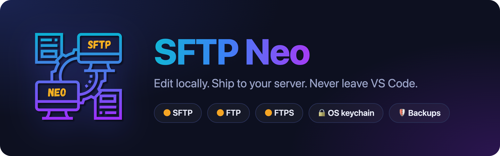
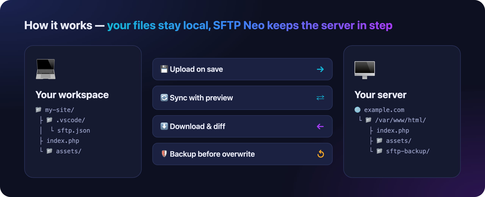
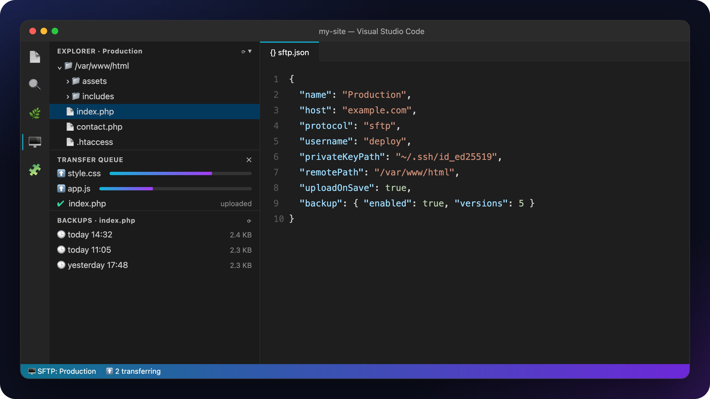
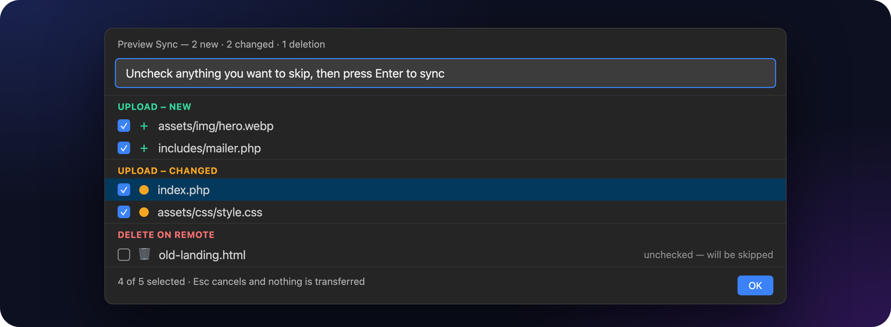

<p align="center">
  
</p>

<p align="center">
  <a href="https://marketplace.visualstudio.com/items?itemName=philipdaoud.sftp-neo"></a>
  <a href="https://open-vsx.org/extension/PhilipDaoud/sftp-neo"></a>
  <a href="https://github.com/philipdaoud/sftp-neo/releases"></a>
  <a href="./LICENSE"></a>
</p>

<p align="center">
  <b>SFTP Neo</b> keeps a local folder and a remote server in sync over <b>SFTP</b>, <b>FTP</b>, or <b>FTPS</b>.<br>
  Upload on save, browse the server in the sidebar, preview syncs before they run, and roll back with automatic backups.
</p>

<p align="center">
  <a href="#-quick-start">⚡ Quick start</a> ·
  <a href="#%EF%B8%8F-everyday-commands">⌨️ Commands</a> ·
  <a href="#-common-setups">🧩 Setups</a> ·
  <a href="#-security">🔐 Security</a> ·
  <a href="#-troubleshooting">🩺 Troubleshooting</a> ·
  <a href="#-documentation">📖 Docs</a>
</p>

---

## ✨ Features

|   |   |
|---|---|
| 💾 **Upload on save** — every save goes straight to the server | 🌐 **Remote Explorer** — browse, open, rename, move and delete remote files |
| 🔄 **Sync** — local → remote, remote → local, or both ways | 👀 **Preview Sync** — review and untick every change before it runs |
| 🛡️ **Backups** — versioned copies before anything is overwritten | 📊 **Transfer Queue** — live progress, cancel anything in flight |
| 🎭 **Profiles** — switch between dev, staging and production | 📂 **Multiple folders** — send different folders to different servers |
| 🔑 **SSH keys & agents** — keys, ssh-agent, Pageant, `~/.ssh/config` | 🔗 **Jump hosts** — reach internal servers through a bastion |
| 🔒 **OS keychain** — passwords never stored in `sftp.json` | 🧭 **Host-key checks** — SHA256 fingerprints, per-workspace trust |

<p align="center">
  
</p>

---

## ⚡ Quick start

### 1️⃣ Install

Install **SFTP Neo** from the [VS Code Marketplace](https://marketplace.visualstudio.com/items?itemName=philipdaoud.sftp-neo) or [Open VSX](https://open-vsx.org/extension/PhilipDaoud/sftp-neo), or search for `sftp-neo` in the Extensions view (`Ctrl+Shift+X` / `Cmd+Shift+X`).

### 2️⃣ Create a config

Open your project folder, then either:

- click the **SFTP** icon in the Activity Bar and choose **Create SFTP Config**, or
- open the Command Palette (`Ctrl+Shift+P` / `Cmd+Shift+P`) and run **`SFTP: Config`**.

This creates `.vscode/sftp.json`. Fill in your server:

```json
{
  "name": "My Server",
  "host": "example.com",
  "protocol": "sftp",
  "port": 22,
  "username": "deploy",
  "remotePath": "/var/www/html",
  "uploadOnSave": true
}
```

> 💡 **No password in the file.** Leave `password` out. SFTP Neo asks the first time you connect and offers to save it in your OS keychain.

### 3️⃣ Start working

- **Get the files:** run **`SFTP: Download Project`**.
- **Edit and save:** with `uploadOnSave` on, each save is uploaded.
- **Browse the server:** open the **SFTP** sidebar.
- **Right-click** any file or folder in the Explorer for upload, download, sync and diff.

<p align="center">
  
</p>

---

## ⌨️ Everyday commands

Run them from the Command Palette, or right-click a file or folder.

| | Command | What it does |
|---|---|---|
| ⬆️ | `SFTP: Upload Active File` | Upload the file you're editing |
| ⬆️ | `SFTP: Upload Changed Files` — `Ctrl+Alt+U` | Upload the files Git reports as changed |
| ⬇️ | `SFTP: Download Project` | Download the whole `remotePath` |
| 🔄 | `SFTP: Sync Local -> Remote` | Make the server match your folder |
| 🔄 | `SFTP: Sync Remote -> Local` | Make your folder match the server |
| 👀 | `SFTP: Preview Sync` | Choose a direction and review every change first |
| 🔍 | `SFTP: Diff Active File with Remote` | Compare your copy with the server's |
| 🎭 | `SFTP: Set Profile` | Switch between profiles |
| 🖥️ | `SFTP: Open SSH in Terminal` | Open an SSH session to the server |
| 🧹 | `SFTP: Delete Saved Password` | Remove a password from the keychain |

📖 Full list: [docs/commands.md](./docs/commands.md)

---

## 🧩 Common setups

Copy only the options you need. Every option is documented in [docs/options.md](./docs/options.md).

<details>
<summary>🔑 <b>SSH key</b></summary>

```json
{
  "host": "example.com",
  "username": "deploy",
  "privateKeyPath": "~/.ssh/id_ed25519",
  "remotePath": "/var/www/html"
}
```

Is the key protected by a passphrase? Add `"passphrase": true`. SFTP Neo asks once and can save it in your keychain.

</details>

<details>
<summary>🗝️ <b>SSH agent (no passwords at all)</b></summary>

Load your key once with `ssh-add ~/.ssh/id_ed25519`, then point SFTP Neo at the agent:

| Platform | `agent` value |
|---|---|
| 🍎 macOS / 🐧 Linux | `"$SSH_AUTH_SOCK"` (read from the environment) |
| 🪟 Windows OpenSSH | `"\\\\.\\pipe\\openssh-ssh-agent"` |
| 🪟 Pageant | `"pageant"` |

```json
{
  "host": "example.com",
  "username": "deploy",
  "agent": "$SSH_AUTH_SOCK",
  "privateKeyPath": "~/.ssh/id_ed25519",
  "identitiesOnly": true,
  "remotePath": "/var/www/html"
}
```

With `privateKeyPath` set, the agent signs with that key, so the key's passphrase isn't needed. `identitiesOnly` offers only that key. This avoids *"Too many authentication failures"* when the agent holds many keys.

</details>

<details>
<summary>📇 <b>Reuse <code>~/.ssh/config</code></b></summary>

Set `host` to an alias from your SSH config. SFTP Neo reads `HostName`, `Port`, `User`, `IdentityFile`, `IdentitiesOnly` and `ServerAliveInterval` from it:

```json
{
  "host": "my-server-alias",
  "remotePath": "/var/www/html"
}
```

Use `sshConfigPath` if your config file lives somewhere else.

</details>

<details>
<summary>🎭 <b>Profiles: dev, staging, production</b></summary>

```json
{
  "username": "deploy",
  "remotePath": "/var/www/html",
  "profiles": {
    "dev":  { "host": "dev.example.com",  "uploadOnSave": true },
    "prod": { "host": "prod.example.com", "uploadOnSave": false }
  },
  "defaultProfile": "dev"
}
```

Switch with **`SFTP: Set Profile`**. A profile can override any option.

</details>

<details>
<summary>📂 <b>Different folders to different servers</b></summary>

`sftp.json` can hold an array. Each entry syncs its own `context` folder:

```json
[
  { "name": "Frontend", "context": "web/dist", "host": "cdn.example.com", "remotePath": "/static" },
  { "name": "Backend",  "context": "api",      "host": "api.example.com", "remotePath": "/srv/api" }
]
```

</details>

<details>
<summary>🔗 <b>Through a jump host (bastion)</b></summary>

```json
{
  "host": "bastion.example.com",
  "username": "jump",
  "privateKeyPath": "~/.ssh/id_ed25519",
  "remotePath": "/srv/app",
  "hop": {
    "host": "app.internal",
    "username": "deploy",
    "privateKeyPath": "~/.ssh/id_ed25519"
  }
}
```

</details>

<details>
<summary>📡 <b>FTP and FTPS</b></summary>

```json
{
  "host": "ftp.example.com",
  "protocol": "ftp",
  "port": 21,
  "username": "deploy",
  "secure": true,
  "remotePath": "/public_html"
}
```

`"secure": true` turns on FTPS (TLS). Use `"implicit"` for implicit FTPS, or leave `secure` out for plain FTP.

</details>

---

## 👀 Preview before you sync

**`SFTP: Preview Sync`** lists every upload and deletion before anything happens. Untick what you want to skip, then press **Enter**. Press **Esc** and nothing is transferred.

Regular syncs show the same list automatically whenever they would **delete** files. You can change this with `syncOption.preview`: `"onDelete"` (the default), `"always"` or `"never"`.

<p align="center">
  
</p>

---

## 🛡️ Backups

Turn on backups and SFTP Neo saves a timestamped copy of every remote file before overwriting it:

```json
{
  "backup": { "enabled": true, "location": "remote", "versions": 5 }
}
```

- 📍 `location`: `"remote"` keeps copies on the server; `"local"` keeps them in your workspace.
- 🔢 `versions`: how many copies to keep per file. Older ones are removed automatically.
- 🗑️ `onDelete`: also back up files before they are deleted.

Select a file in the Remote Explorer to see its versions in the **Backups** view. From there you can open, **restore**, or delete any version. A failed backup never blocks an upload.

---

## 🔐 Security

- 🔒 **Passwords and passphrases** are stored in your OS keychain (macOS Keychain, Windows Credential Manager, libsecret), not in `sftp.json`. Remove them with `SFTP: Delete Saved Password`.
- 🚫 **`.vscode` is never transferred.** That folder holds `sftp.json`, so it can't leak to your server.
- 🧭 **Host keys are verified** with OpenSSH-style `SHA256:` fingerprints. If a key changes, you see both fingerprints and decide.
  - `"hostKeyChecking": "accept-new"` trusts new servers automatically. A *changed* key still asks.
  - For throwaway test servers, the **user setting** [`sftp.skipHostKeyVerification`](./docs/setting.md#skiphostkeyverification) lists hosts whose key isn't checked. A workspace can't set it.
- 🧯 **Destructive actions ask first**: deletes, and syncs that would delete files.

---

## 🩺 Troubleshooting

1. Open **Settings** (`Ctrl+,` / `Cmd+,`) and turn on **`sftp.debug`**.
2. Reload VS Code and repeat the problem.
3. Open **View → Output** and pick **SFTP** from the list.

| Problem | Try |
|---|---|
| *Too many authentication failures* | Set `privateKeyPath` and `"identitiesOnly": true` next to `agent` |
| *Timed out while waiting for handshake* | Check `host` and `port`, or raise `connectTimeout` |
| *Host key has CHANGED* | Expected after a rebuild? Choose **Accept New Key** |
| *Error: Failure* | Point `remotePath` at the real folder, not a symlink |

More answers in the [FAQ](./FAQ.md). Still stuck? [Open an issue](https://github.com/philipdaoud/sftp-neo/issues) and include the SFTP output log.

---

## 📖 Documentation

| | |
|---|---|
| ⚙️ [All `sftp.json` options](./docs/options.md) | Every option, its default, and what it does |
| ⌨️ [Commands](./docs/commands.md) | Every command and where to find it |
| 🎛️ [VS Code settings](./docs/setting.md) | Extension-wide settings such as `sftp.debug` |
| ❓ [FAQ](./FAQ.md) | Common errors and how to fix them |
| 📝 [Changelog](./CHANGELOG.md) | What's new in each release |

---

## 🤝 Contributing

Bug reports, ideas and pull requests are welcome. See [CONTRIBUTING.md](./CONTRIBUTING.md).

```bash
git clone https://github.com/philipdaoud/sftp-neo.git
cd sftp-neo
npm install
npm test
```

Press **F5** in VS Code to launch a development window with the extension loaded.

---

<p align="center">
  MIT licensed · Built by <a href="https://github.com/philipdaoud">Philip Daoud</a>
</p>
